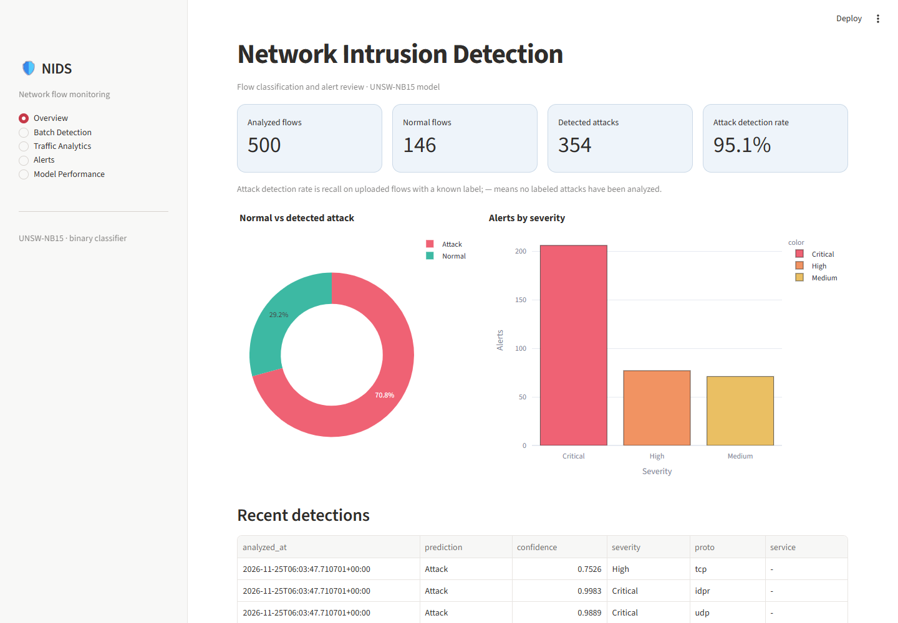
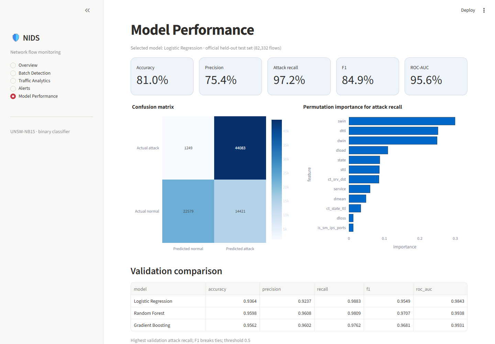
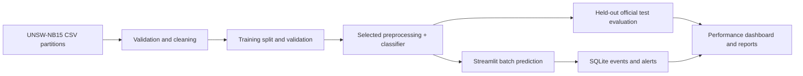

# Network Intrusion Detection System

A Streamlit dashboard and reproducible binary classifier for **UNSW-NB15 network-flow records**. Upload a CSV to flag likely attacks, review severity-ranked alerts, inspect traffic patterns, and see the model's held-out evaluation.

> This is a learning and portfolio project. It classifies pre-extracted flow features; it does not capture packets or provide production network protection.

## Dashboard





The dashboard provides Overview, Batch Detection, Traffic Analytics, Alerts, and Model Performance views. “Live” detection means results appear after an upload is analyzed. Alerts and flow summaries are stored in local SQLite at `data/events.sqlite3`.

## Quick start

Python 3.15 is tested. From the repository root:

```powershell
python -m venv .venv
.venv\Scripts\python -m pip install -r requirements.txt
.venv\Scripts\python scripts/download_data.py
.venv\Scripts\python -m src.preprocess
.venv\Scripts\python scripts/generate_eda.py
.venv\Scripts\python -m src.train
.venv\Scripts\streamlit run dashboard/app.py
```

On macOS/Linux, replace `.venv\Scripts\python` with `.venv/bin/python` and `.venv\Scripts\streamlit` with `.venv/bin/streamlit`. To run tests, install `requirements-dev.txt` and run `python -m pytest -q`.

The optional browser smoke and screenshot scripts use an installed Chrome browser. Set `NIDS_CHROME` to its executable path if it is outside the usual location.

The downloader verifies SHA-256 hashes for a pinned [public copy of the official partitions](https://huggingface.co/datasets/Mouwiya/UNSW-NB15-small/tree/6f5f54594dfc80c84264aec4c7cc3d9b162f1e2f). The [UNSW dataset page](https://research.unsw.edu.au/projects/unsw-nb15-dataset) is the primary source; its download link may require Microsoft sign-in. If you obtain the two files directly from UNSW, place `UNSW_NB15_training-set.csv` and `UNSW_NB15_testing-set.csv` in `data/raw/` and skip the downloader. The expected partitions have **175,341 training** and **82,332 test** rows. The downloader's pinned hashes apply to its specified public copy; the preprocessing script separately checks row counts and schema.

## Architecture



`src/preprocess.py` verifies the two partitions and saves normalized CSVs to `data/processed/`. `src/train.py` splits only the official training partition for validation, fits each model's preprocessing inside its pipeline, selects by attack recall then F1, retrains on all official training rows, and evaluates once on the official test partition. `src/predict.py` uses the saved pipeline for one flow or a batch. The target is `label` (`0` normal, `1` attack). `id`, `attack_cat`, and `label` are excluded from the features to prevent target leakage. The official pre-split files provide 42 model features, including `proto`, `service`, and `state`.

### Validation comparison

| Model | Accuracy | Precision | Attack recall | F1 | ROC-AUC |
|---|---:|---:|---:|---:|---:|
| Logistic Regression | 93.64% | 92.37% | **98.83%** | 95.49% | 98.43% |
| Random Forest | **95.98%** | **96.08%** | 98.09% | **97.07%** | **99.38%** |
| Gradient Boosting | 95.62% | 96.02% | 97.62% | 96.81% | 99.31% |

The agreed recall-first rule selects **Logistic Regression**. “Gradient Boosting” here is scikit-learn's histogram-based classifier. Random Forest is also saved locally as `models/nids_random_forest.pkl`. The deployed artifact is `models/nids_logistic_regression.pkl`. The model files are generated by training and excluded from Git to keep the repository small.

### Official held-out test result

| Accuracy | Precision | Attack recall | F1 | ROC-AUC |
|---:|---:|---:|---:|---:|
| 80.97% | 75.35% | **97.24%** | 84.91% | 95.56% |

| | Predicted normal | Predicted attack |
|---|---:|---:|
| Actual normal | 22,579 | 14,421 |
| Actual attack | 1,249 | 44,083 |

These results are from the **82,332-row official test partition**, not the validation split. The high recall comes with many false alerts on normal test flows. The [model comparison](reports/model_comparison.csv), [evaluation JSON](reports/evaluation.json), [feature importance](reports/feature_importance.csv), [dataset inspection](reports/dataset_inspection.md), and [interactive EDA charts](reports/eda_charts.html) contain the generated details.

## Prediction CSV and alerts

Upload a CSV with the 42 feature columns used in the official split. `label`, `attack_cat`, and `id` are optional; other extra columns are ignored for inference. The dashboard reports missing required columns. Unknown protocol, service, or state values and missing or infinite numerical values are handled by the fitted pipeline. A result includes the class, confidence, attack probability, severity, and an observed-signal summary. That summary points out values above the training 95th percentile; it is **not a causal model explanation**.

| Result | Severity |
|---|---|
| Normal | Low |
| Attack probability 50–<75% | Medium |
| Attack probability 75–90% | High |
| Attack probability >90% | Critical |

Severity is based only on the model's attack probability; it is an alert-priority aid, not an estimate of real-world harm.

Attack type is shown only if the uploaded CSV provides an `attack_cat` ground-truth column; otherwise it is “Unknown type.” Overview attack detection rate is recall over uploaded flows with a known `label`; it is unavailable for unlabeled uploads. The pre-split dataset has no flow timestamp or port columns, so time charts use dashboard analysis time and EDA shows services instead of ports.

## Dataset and limitations

The [UNSW-NB15 dataset](https://research.unsw.edu.au/projects/unsw-nb15-dataset) was created in a lab and includes nine attack categories. Cite: **N. Moustafa and J. Slay, “UNSW-NB15: a comprehensive data set for network intrusion detection systems,” MilCIS, 2015**, DOI [10.1109/MilCIS.2015.7348942](https://doi.org/10.1109/MilCIS.2015.7348942). UNSW grants free academic research use and asks users to cite its publications; commercial use requires agreement with the authors. Raw and processed CSVs are downloaded locally and are not included in this repository.

The benchmark's age and lab origin limit how well its results predict performance on current networks. A binary alert does not identify an attack category. Probabilities are model scores and are not calibrated operational risk estimates. Future work could add a separately evaluated attack-type classifier, packet capture and feature extraction, newer traffic for retraining, rule-based signals, and packaging for deployment.
